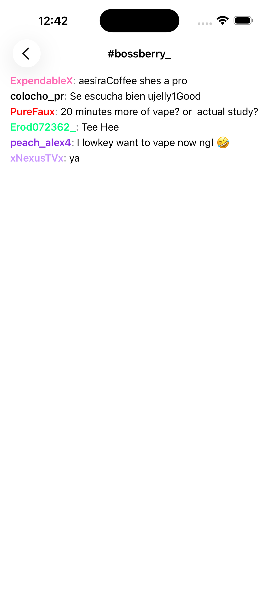

# chattr slice-1 — Completed

**Date:** 2026-05-26
**Status:** ✅ End-to-end validated on iOS Simulator (iPhone 17 Pro, iOS 26.5)

## What works

Slice-1's goal was the thinnest possible end-to-end path: launch app → sign in with Twitch → see followed channels → tap one → watch real chat messages flow. All of that is working.

- **Sign-in flow:** ASWebAuthenticationSession presents Twitch's authorization page. After the user authorizes, Twitch's HTTPS callback is bridged through a Vercel serverless function that exchanges the auth code for tokens (using `client_secret` stored server-side as a Vercel env var), then 302-redirects to `chattr://oauth-complete?access_token=...&refresh_token=...`. The custom-scheme redirect is intercepted inside the auth sheet via `callbackURLScheme: "chattr"` — silent, no "Open in chattr?" prompt.
- **Account persistence:** Tokens land in `KeychainTokenStore(identifier: "chattr.account.<userId>")` via TwitchKit. The `Account` row is persisted via SwiftData, keyed by Twitch user_id. `AccountStore.add(token:scopes:)` probes `/users` with an in-memory token store, learns the userId, then constructs the persistent client.
- **Followed channels:** `HelixClient.fetchFollowedChannelsPage(forUserID:first:after:)` loads on screen appear. `ChannelListScreen` renders a SwiftUI `List` with NavigationLink to the chat screen.
- **Live chat:** Tapping a channel constructs a `ChannelSession` actor with the active account's `TwitchClient`. `EventSubClient.connect()` opens the WebSocket; `subscribe(.Chat.message(broadcasterID:, userID:))` enrolls for messages. Events stream into a 500-element ring buffer with 15ms debounced snapshots, surfaced via `nonisolated let lines: AsyncStream<[ChatMessage]>`. SwiftUI's `ScrollView` + `LazyVStack` renders `username: text` rows, auto-scrolling to the bottom.

## Architecture validated by this slice

| Concern | Implementation |
|---|---|
| Multi-account support | `AccountStore` (`@MainActor final class`) with per-account `tokenNamespace`; one `TwitchClient` cached per userId |
| Token storage | TwitchKit's `KeychainTokenStore(identifier:)` keyed per account |
| OAuth without shipping secrets | Vercel-bridge token exchange (`~/Dev/chattr-auth/api/callback.js`); `client_secret` stays in `TWITCH_CLIENT_SECRET` env var |
| Twitch HTTPS-only redirect URI | Bridge accepts at `https://chattr-auth.vercel.app/oauth/callback`, 302s to `chattr://oauth-complete?...` |
| iOS callback intercept | `ASWebAuthenticationSession` with `callbackURLScheme: "chattr"`; URL scheme registered in Info.plist |
| Concurrency boundaries | `Account`/`JoinedChannel` are `@Model` (implicit MainActor); `AccountStore`+`ChannelSessionRegistry` are `@MainActor final class` (handle `@Model` instances); `ChannelSession` is an `actor` (handles plain values + Sendable structs only); cross-boundary delivery via `nonisolated AsyncStream` |
| EventSub subscription lifecycle | `ChannelSession.start()` → `connect()` + `subscribe()`; ring buffer accumulates events; `lines` stream emits coalesced snapshots; `stop()` cancels |
| SwiftData persistence | In-memory `ModelContainer` for tests; on-disk for production; `@Query` in `RootView` auto-transitions from `SignInView` to `ChannelListScreen` on account insert |

## Package structure

```
~/Dev/twitch-kit/                       ← external SPM package (also consumed by Streamly)
~/Dev/chattr-auth/                      ← Vercel OAuth bridge (separate git repo)
~/Dev/chattr/
  chattr.xcodeproj
  chattr/                               ← app target source
    chattrApp.swift                     ← @main, DI wiring
    ContentView.swift                   ← unused (vestigial Xcode template)
    Info.plist                          ← CFBundleURLTypes registers chattr:// scheme
    chattr.entitlements                 ← empty (cleaned up after Universal Link experiment)
  Packages/
    Core/                               ← AppLogger, AppError
    DesignSystem/                       ← Brand.accent stub
    Accounts/                           ← Account model, AccountStore, OAuthFlow, SignInView, tests
    Channels/                           ← JoinedChannel model, ChannelSession, ChannelSessionRegistry, placeholder tests
    Features/                           ← RootView, ChannelListScreen, ChatScreen
```

Total: 6 local SPM packages + 1 external + 1 Vercel project.

## What's deliberately deferred to later slices

- **Backfill via `recent-messages.robotty.de`** — chat starts empty; mid-stream joins show no history until live messages arrive
- **Third-party emote substitution** (7TV / BTTV / FFZ) via an `EmoteSources` package + `EmoteIndex` actor
- **`ChatModel.Normalizer`** — raw EventSub fragments → display-ready `ChatLine.runs` with emote substitution
- **UIKit `UICollectionView` chat list** with `UIHostingConfiguration` cells (slice-1 uses SwiftUI ScrollView + LazyVStack)
- **Liquid Glass theming polish** (Brand has only a single accent color stub)
- **Multi-account UI** — switcher, add additional account (architecture supports it; UI doesn't yet)
- **Sub / raid / message-delete / chat-clear event rendering** as inline bubbles (only `channel.chat.message` is subscribed)
- **Sending messages**, replies, /me, emote picker
- **Highlight sound on @-mentions**
- **Stick-to-bottom controller** with "↓ N new messages" pill
- **Settings screen**, highlight keywords, account management UI
- **PKCE** — Twitch's authorization-code-grant flow doesn't support it; we use the Vercel-bridge pattern instead

## OAuth architecture details

The OAuth dance landed on a specific shape after exploring four alternatives. Documented here for future reference:

### What we use

**Server-side token exchange via Vercel function + custom URL scheme intercept.**

```
chattr (ASWebAuthenticationSession with callbackURLScheme: "chattr")
   ↓
twitch.tv/oauth2/authorize?...&redirect_uri=https://chattr-auth.vercel.app/oauth/callback
   ↓ (user authorizes)
HTTP 302 → https://chattr-auth.vercel.app/oauth/callback?code=...
   ↓
Vercel function (chattr-auth/api/callback.js):
   - Reads code, calls https://id.twitch.tv/oauth2/token with TWITCH_CLIENT_ID + TWITCH_CLIENT_SECRET env vars
   - Receives {access_token, refresh_token, expires_in, scope, token_type}
   - HTTP 302 → chattr://oauth-complete?access_token=...&refresh_token=...&...
   ↓
ASWebAuthenticationSession intercepts chattr:// scheme (system privileged intercept, no "Open in chattr?" prompt)
   ↓
OAuthFlow.run completion fires with the chattr:// URL; we parse tokens into TwitchKit.OAuthToken
   ↓
AccountStore.add(token:scopes:) — probe /users for userId, persist Account, cache per-account TwitchClient
```

### What we explored and rejected

| Approach | Why rejected |
|---|---|
| Universal Link + ASWebAuthenticationSession.Callback.https() | Required Apple Team ID in publicly-served AASA file; webcredentials entitlement; brittle AASA cache propagation; privacy concern about Team ID exposure |
| WKWebView intercepting `https://localhost` (Streamly's pattern) | Works, but embedded WebView is Apple-deprecation-trending and may trigger App Store review concerns; no Safari cookie sharing |
| `chattr://` direct as Twitch redirect URI | Twitch dev portal rejects custom URL schemes ("Redirect URIs must use HTTPS protocol") |
| Shipping `client_secret` in chattr binary (Streamly's approach) | Extractable via `strings binary | grep`; we chose to keep `client_secret` server-side instead |

### Why PKCE isn't an option

Verified via Twitch's OIDC discovery metadata (`token_endpoint_auth_methods_supported: ["client_secret_post"]`, no `code_challenge_methods_supported`). Twitch's authorization-code-grant flow does not support PKCE. The Vercel-bridge pattern is the alternative.

## Smoke test



## Commit history

Slice-1 work spans ~40 commits across three repos:

- `~/Dev/chattr/` — the app itself (foundation, packages, OAuth iterations, smoke test fixes)
- `~/Dev/chattr-auth/` — the Vercel OAuth bridge (initial AASA setup, then pivoted to token-exchange function)
- `~/Dev/twitch-kit/` — the shared TwitchKit package (predates slice-1 — extracted from Streamly + evolved by Andrew before slice-1 began)

## Next steps

Slice-2 plan covers:

1. **Backfill** via `recent-messages.robotty.de` on channel join
2. **EmoteSources package** — 7TV / BTTV / FFZ providers + unified `EmoteIndex` actor
3. **ChatModel.Normalizer** — turns raw `ChatMessage.fragments` into display-ready `ChatLine.runs` with third-party emote substitution
4. **UIKit chat list** — `UICollectionView` + `UIHostingConfiguration` cells, validated under synthetic 100 msg/sec load via instrumentation
5. **Liquid Glass polish** — accent palette, materials, typography tokens, real chattr icon
6. **Sub / raid / message-delete / chat-clear inline bubbles** — extend EventSub subscriptions and render via separate `ChatLine.kind` cases

Tracked in `docs/superpowers/specs/2026-05-24-chattr-design.md` (the original design spec) and to-be-written `docs/superpowers/plans/<date>-chattr-slice-2-*.md` (planned next session).
